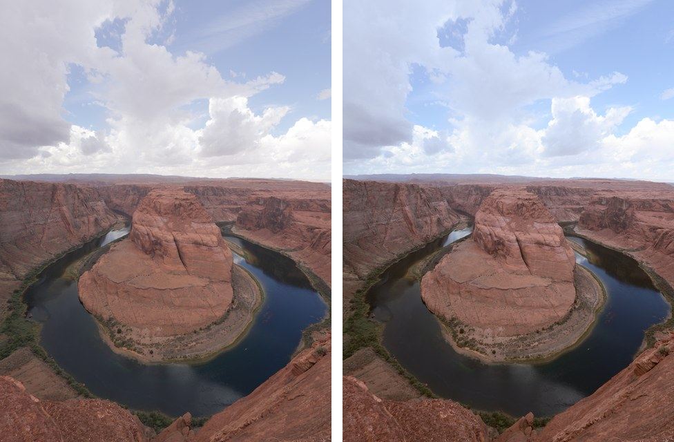

# lookmatch

Give lookmatch one or more photos whose colors you love, plus a folder of your
own photos. It measures both and builds one LUT that gives your camera's
photos that look, including photos you take later. You get a LUT and presets
you can use in Lightroom, Photoshop, DaVinci Resolve, and other editing apps.

> **Status:** early development. The engine's building blocks (color math,
> LUT files, LUT application) work and are tested. Fitting a look from your
> photos is not built yet. Star the repo to hear when the first version is
> ready.

## Built on measurement, not guessing

- **Every number is measured or optimized.** No AI model picks slider values,
  curves, or LUT colors. lookmatch measures the colors in your photos and the
  reference, then solves for the change between them.
- **Same photos, same result.** Random sampling uses a fixed seed, so a run
  is exactly repeatable.
- **Every step is checked.** Each part of the engine is tested against known
  answers and against independent libraries, on every change.
- **Methods come from published color science**, with citations in
  [docs/method.md](docs/method.md).

<picture>
  <source media="(prefers-color-scheme: dark)" srcset="docs/figures/pipeline_dark.svg">
  
</picture>

## See the engine work

lookmatch can't fit a look from photos yet, so these figures check the engine
with a **hand-made test look**: warmer shadows, cooler highlights and a
gentle S-curve. Every figure is computed by lookmatch itself
([docs/figures/make_figures.py](docs/figures/make_figures.py)).

**What the test look does, measured.** A gray ramp from black to white goes
through the LUT, and lookmatch measures the result in OKLab, a color space
built to match how people see color differences.

<picture>
  <source media="(prefers-color-scheme: dark)" srcset="docs/figures/tone_response_dark.svg">
  
</picture>

**On a real photo.** Left: the camera's own JPEG. Right: the same photo with
the test look applied by lookmatch.

**On a test chart.** A gray ramp, the 24-patch ColorChecker and pure
primaries, before (left) and after (right). The same chart and LUT are used
to check that lookmatch, DaVinci Resolve and Photoshop give the same result.

## How it's tested

| What | Checked against | Tolerance |
|---|---|---|
| sRGB, linear and OKLab conversions | Round trip over 10,000 values | 0.0001 |
| OKLab values | colour-science (independent library) | 0.002 |
| Phone photos in Display P3 | colour-science conversion | 2 of 255 levels |
| `.cube` LUT files | Write, then read back | Exact |
| Applying a LUT | SciPy's interpolation | 0.000000000001 |
| A LUT that changes nothing | Photo before and after | Unchanged |
| Test look and test chart | Regenerated from their script | Exact |

All tests run on Python 3.11 and 3.12 for every change
([CI](https://github.com/ShadowSkeleton/lookmatch/actions/workflows/ci.yml)).

## Benchmark (coming)

lookmatch will be scored on looks whose exact answer is known: a LUT is
applied to one photo to make the reference, and to another photo to make the
ground truth. The score is ΔE 2000, the standard measure of color
difference (below about 1, people can't see it). lookmatch will be compared
with doing nothing, Reinhard color transfer, and plain optimal transport. The
results will be published here, failure cases included.

## License

MIT, see [LICENSE](LICENSE).
