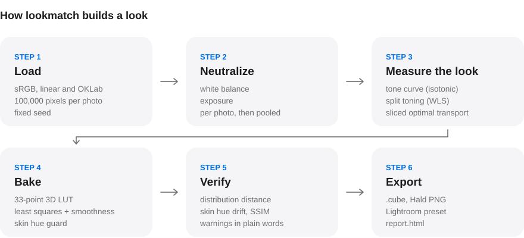
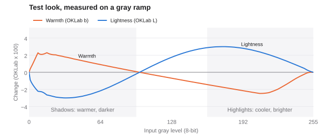
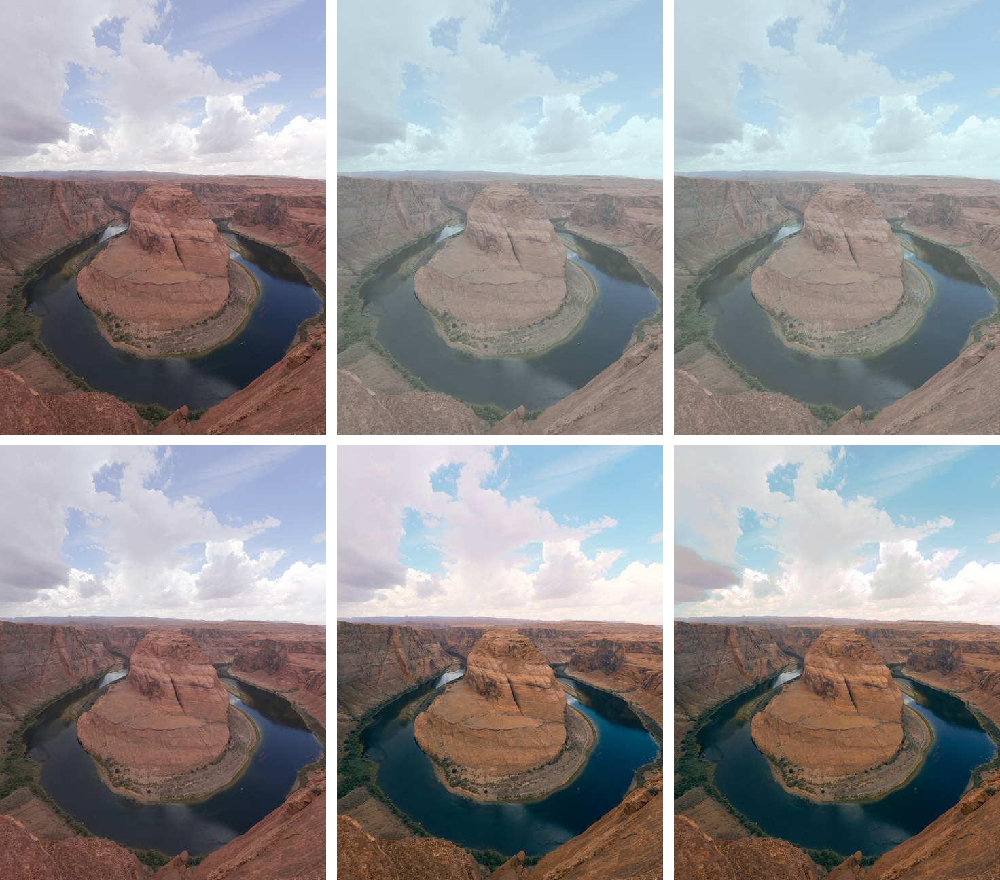
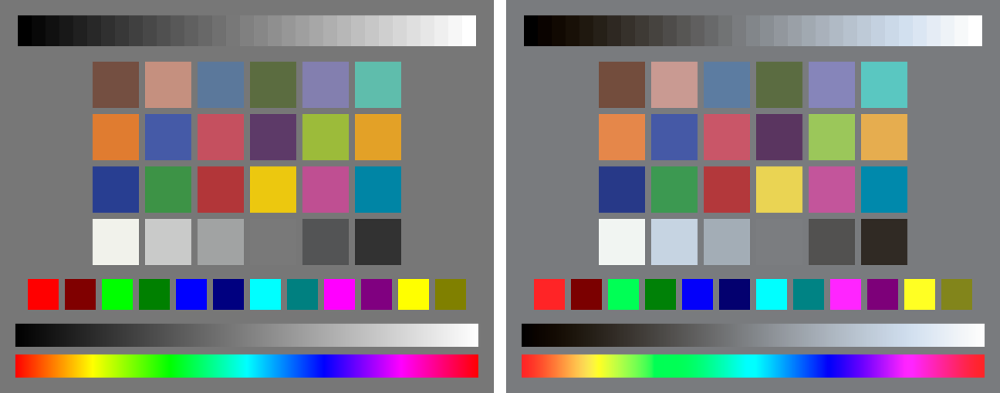

  <b>English</b> · <a href="README.zh-CN.md">简体中文</a>

# lookmatch

Give lookmatch one or more photos whose colors you love, plus a folder of your
own photos. It measures both and builds one LUT that gives your camera's
photos that look, including photos you take later. You get a LUT and presets
you can use in Lightroom, Photoshop, DaVinci Resolve, and other editing apps.

> **Status:** early development, not ready to use yet. The whole engine is
> built and tested, and a LUT from lookmatch looks identical in Photoshop and
> DaVinci Resolve. It matches a look closely when the reference photos show
> the same or similar scenes as your photos. When they show different
> scenes, it learns the safe part of the look (black and white points and
> color tint) and leaves the rest alone: see [Benchmark](#benchmark). Star
> the repo to follow along.

## Built on measurement, not guessing

- **Every number is measured or optimized.** No AI model picks slider values,
  curves, or LUT colors. lookmatch measures the colors in your photos and the
  reference, then solves for the change between them.
- **Same photos, same result.** Random sampling uses a fixed seed, so a run
  is exactly repeatable.
- **Every step is checked.** Each part of the engine is tested against known
  answers and against independent libraries, on every change.
- **Methods come from published color science**, with citations in
  [docs/method.md](docs/method.md).

<picture>
  <source media="(prefers-color-scheme: dark)" srcset="docs/figures/pipeline_dark.svg">
  
</picture>

## See the engine work

These figures check the engine with a **hand-made test look**: warmer
shadows, cooler highlights and a gentle S-curve. Every figure is computed by
lookmatch itself ([docs/figures/make_figures.py](docs/figures/make_figures.py)).

**What the test look does, measured.** A gray ramp from black to white goes
through the LUT, and lookmatch measures the result in OKLab, a color space
built to match how people see color differences.

<picture>
  <source media="(prefers-color-scheme: dark)" srcset="docs/figures/tone_response_dark.svg">
  
</picture>

**Learning a look from photos.** Left: your photo (the camera's own JPEG).
Middle: the target look. Right: the look lookmatch learned from reference
photos, with its default settings, applied to your photo. Top: a bright,
airy Japanese style (日系清新): lifted shadows, soft contrast, pale colors,
cool highlights. Bottom: a strong teal and orange.

| Look | Target vs. original | lookmatch vs. target |
|---|---|---|
| Japanese airy | ΔE 14.8 | **ΔE 0.8** (0.8 to 1.8 across the three demo photos) |
| Teal and orange | ΔE 6.6 | **ΔE 2.7** (2.1 to 2.7) |

ΔE 2000 measures visible color difference: below about 1 is invisible, 2 to
3 is barely noticeable side by side. Both looks are made by lookmatch's own
formulas ([bench/make_looks.py](bench/make_looks.py)), not taken from anyone's
presets. This is the **easiest case**: the references are these same photos
with the look applied, as when you edit a few of your own photos and want
the rest to match. When the references show other scenes, results are less
precise (see [Benchmark](#benchmark)).

**On a test chart.** A gray ramp, the 24-patch ColorChecker and pure
primaries, before (left) and after (right).

**Same result in your apps.** The same LUT, applied to the test chart in
Photoshop and DaVinci Resolve, was measured on all 69 patches: Photoshop
matches lookmatch exactly, and Resolve is within 1 level out of 255
([results](bench/APP_CHECK_RESULTS.md)).

## How it's tested

| What | Checked against | Tolerance |
|---|---|---|
| sRGB, linear and OKLab conversions | Round trip over 10,000 values | 0.0001 |
| OKLab values | colour-science (independent library) | 0.002 |
| Phone photos in Display P3 | colour-science conversion | 2 of 255 levels |
| `.cube` LUT files | Write, then read back | Exact |
| Applying a LUT | SciPy's interpolation | 0.000000000001 |
| Same LUT in Photoshop and Resolve | lookmatch's own result, 69 patches | 0 and 1 of 255 levels |
| Color difference (ΔE 2000) | Published test data (Sharma et al. 2005) | 0.0001 |
| Recovering a known tone curve | Synthetic photos | 0.41% |

All tests run on Python 3.11 and 3.12 for every change
([CI](https://github.com/ShadowSkeleton/lookmatch/actions/workflows/ci.yml)).

## Benchmark

To measure honestly, the benchmark uses looks whose exact answer is known: a
look is applied to some photos to make the "reference" photos, each method
builds a LUT from them, and the LUT is compared with the right answer on your
other photos using **ΔE 2000**, the standard measure of visible color
difference (below about 1, people can't see it). Details:
[bench/README.md](bench/README.md).

Results on 45 of the maintainer's photos (two Sony cameras; city, street,
portraits, night, desert) with 8 known looks, 15 reference photos and 30
input photos per test ([full table](bench/RESULTS.md)). Mean ΔE 2000, lower
is better:

| Method | Same scenes | Different scenes | Photos made worse (different scenes) |
|---|---|---|---|
| No change | 4.51 | 4.51 | – |
| Reinhard color transfer | 3.71 | 7.97 | 84% |
| Plain optimal transport | **0.62** | 7.41 | 77% |
| lookmatch | 0.99 | **3.88** | 41% |

With the same scenes, lookmatch gets within about 1 ΔE of the right answer.
With different scenes, the classic methods make most photos worse than doing
nothing: they mistake the difference between two sets of scenes for a look
(a set of dark canyon photos teaches "darken everything"). lookmatch avoids
this by measuring how alike the scenes are and, when they differ, learning
only what holds up across scenes: black and white points and the color tint
that all the reference photos agree on. That makes it the only method that
beats doing nothing on average, and on 6 of 8 looks. On the two looks that
barely change anything, it still adds about 2 ΔE that isn't there (down
from 7). What it can't learn yet from other
scenes is midtone contrast, saturation and hue-selective changes, so
references that resemble your photos still give the best result. How it
works: [docs/method.md](docs/method.md#when-the-scenes-differ).

## License

MIT, see [LICENSE](LICENSE).
